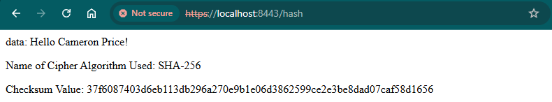
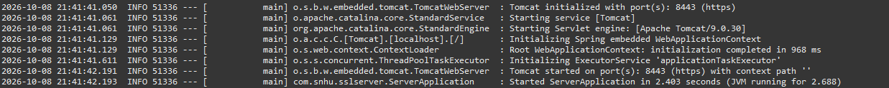
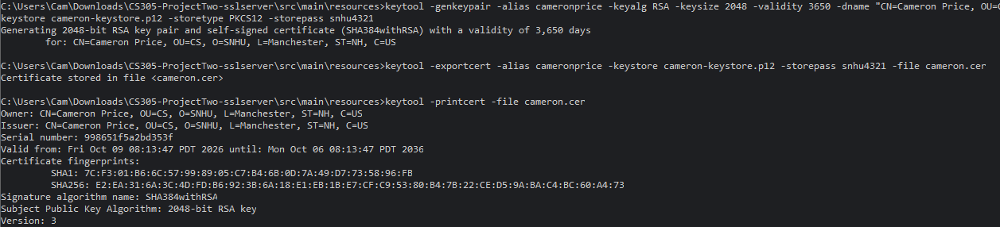
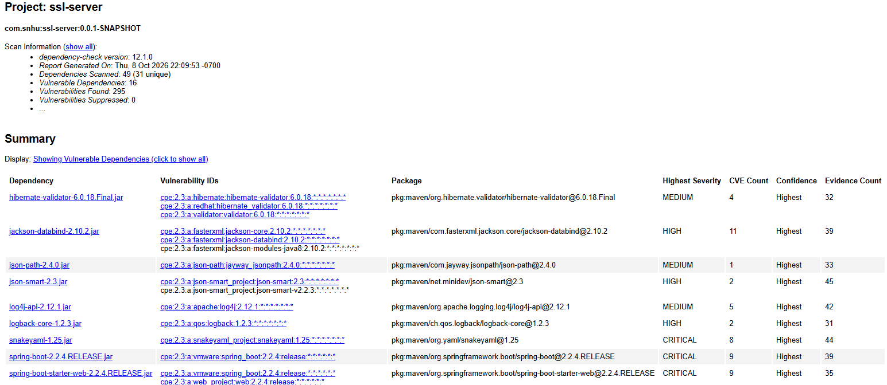

<div align="center">

# 🔐 Artemis Financial: Secure Software Refactor


*A Spring Boot web app refactored to serve a SHA-256 checksum over HTTPS with a self-signed certificate, then re-scanned with OWASP Dependency-Check to prove the refactor added no new vulnerable dependencies.*

</div>

---

## 📖 About the Project

Artemis Financial is a consulting firm that builds individualized financial plans for its customers: savings, retirement, investments, and insurance. It runs a public web interface, and it hired Global Rain, the software firm I worked for in the course scenario, to modernize that interface with current security. The specific request was a data verification step, a checksum on data the application transfers, delivered over secure communications.

The course ran in two parts. Project One was a vulnerability assessment of Artemis Financial's REST API, built from a manual code review plus an automated dependency scan. Project Two, the artifact in this repository, is the fix: refactor the code to add the checksum and HTTPS, then prove the refactor did not introduce anything new.

---

## 📂 What Is In This Repo

| File | What it is |
|:-----|:-----------|
| `CS 305 Project Two - Practices for Secure Software Report - Cameron Price.docx` | The portfolio artifact. The cipher recommendation and its justification, certificate generation, the checksum deployment, HTTPS verification, secondary and functional testing, and a summary of how the code was refactored. |
| `refactored-code/` | The Spring Boot application after refactoring. `ServerApplication.java` holds the `/hash` route, `application.properties` turns on HTTPS on port 8443, and `pom.xml` wires in OWASP Dependency-Check. |
| `images/` | The screenshots used below, cropped to the evidence. |
| `README.md` | This file, including the Module Eight reflection. |

---

## ✅ Proof It Works

**The checksum, served over HTTPS.** The page shows the unique data string, the algorithm, and the SHA-256 digest.



You can check the digest yourself. It is the SHA-256 of the exact string on the page:

```bash
printf '%s' "Hello Cameron Price!" | sha256sum
# 37f6087403d6eb113db296a270e9b1e06d3862599ce2e3be8dad07caf58d1656
```

**The server starting on port 8443 over HTTPS, with no errors.**



**A self-signed certificate generated with Java keytool.** Owner and Issuer are the same entity, which is what makes it self-signed.



**OWASP Dependency-Check, run after the refactor.**



The 16 vulnerable dependencies all came with the original code base: Spring Boot 2.2.4, Tomcat 9.0.30, Jackson, SnakeYAML, and the libraries they pull in. The refactored `pom.xml` declares exactly the same three dependencies as the course's starting code. The checksum uses `MessageDigest` from the JDK and HTTPS is Spring configuration, so the refactor added nothing to scan. That was the question the secondary test had to answer.

---

## ⚙️ How to Run It

### Prerequisites

* A JDK, version 8 or newer. I ran it on JDK 25 inside Eclipse.
* Eclipse with Maven support (m2e), or Maven installed on the command line.

### Option A: Eclipse

1. File, Import, Maven, Existing Maven Projects, then select the `refactored-code` folder.
2. Right-click the project, Run As, Java Application, and pick `ServerApplication`.
3. Open `https://localhost:8443/hash`. The browser will warn about the self-signed certificate. That is expected; continue to the page.

### Option B: Command Line

```bash
cd refactored-code
mvn spring-boot:run
```

### Running the Dependency Scan

```bash
mvn dependency-check:check
```

The report lands in `target/dependency-check-report.html`. The first run downloads the full National Vulnerability Database, which is slow without a free NVD API key.

---

## 🛡️ A Note on the Keystore

`application.properties` holds the keystore password in plain text, and `keystore.p12` is committed. Both belong to the classroom certificate that shipped with the course code base, and they are here so the project runs exactly as submitted. In production the password would come from an environment variable or a secret store, and no keystore would be committed. For the certificate I generated myself, only the public `cameron.cer` is in the repo. The private key stayed on my machine.

---

## 🌟 Key Highlights

* **One constant names the algorithm.** `ALGORITHM = "SHA-256"` feeds both `MessageDigest.getInstance` and the label on the page, so the two can never disagree.
* **The charset is fixed to UTF-8.** The same text encoded two different ways produces two different digests, and a checksum that changes with the machine it ran on is not a checksum.
* **The scanner had to be fixed before it could scan.** The course's plug-in version, 5.3.0, can no longer download vulnerability data because NIST retired the legacy feeds it used, so it fails with HTTP 403. I moved it to 12.1.0 and turned off the OSS Index analyzer after it failed authentication.
* **Checked after the change.** I ran the scan again after the refactor and traced every finding to the dependency that brought it in.

---

## 🧠 Reflection

### Briefly summarize your client, Artemis Financial, and its software requirements. Who was the client? What issue did the company want you to address?

Artemis Financial is a consulting company that creates individualized financial plans covering savings, retirement, investments, and insurance. It runs a public web interface that client financial data passes through, and it wanted that interface modernized with current, effective security. The specific requirement was a data verification step, a checksum on data the application transfers, delivered over secure communications. In Project One I assessed their existing code for vulnerabilities, and in Project Two I refactored it to meet those requirements.

### What did you do well when you found your client's software security vulnerabilities? Why is it important to code securely? What value does software security add to a company's overall well-being?

I didn't treat the scanner as the assessment. The dependency scan flagged the obvious problem, Bouncy Castle 1.46, a cryptography library from 2011, but the most serious findings came from reading the code: a database connection that authenticates as root with the password hardcoded in source, a bare JDBC URL with no encryption, a connection that is never closed, and an account balance exposed with default access and no validation. Each of those was a decision someone made at a keyboard, which is why secure coding belongs to developers and not only to a security team. For a financial planning firm, the value of security is trust and legal exposure. A breach of client financial data is a regulatory event under the Gramm-Leach-Bliley Act, not just an outage, and it is the kind of failure clients leave over.

### Which part of the vulnerability assessment was challenging or helpful to you?

The vulnerability assessment process flow diagram was the most helpful part. Deciding which of the seven areas of security applied before reading a line of code changed what I noticed when I did read it. The hardest part was the tooling rather than the analysis. The dependency-check plug-in version in the course's starting code can no longer download vulnerability data, so the first scan failed with HTTP 403 until I tracked the cause to NIST retiring its legacy data feeds, upgraded the plug-in, and turned off an analyzer that needed credentials. Debugging the scanner taught me as much as the scan did.

### How did you increase layers of security? In the future, what would you use to assess vulnerabilities and decide which mitigation techniques to use?

Each layer covers a different failure. The SHA-256 checksum protects integrity, because if the data changes, the digest changes. HTTPS protects confidentiality in transit, so nothing the application sends is readable on the wire. Dependency scanning in the build covers the code I did not write. In the future I would keep pairing an automated scanner for known vulnerabilities in third-party code with manual review for logic and design flaws in my own code, because neither finds what the other finds. To decide which mitigation comes first, I would rank findings by exploitability and impact together, and check CISA's Known Exploited Vulnerabilities catalog alongside the CVSS score instead of sorting on CVSS alone. Dependency-Check already marks known-exploited findings in its report.

### How did you make certain the code and software application were functional and secure? After refactoring the code, how did you check to see whether you introduced new vulnerabilities?

For function, I ran the application and confirmed that Tomcat started on port 8443 over HTTPS with no errors, then loaded the `/hash` route and checked that the digest matched the data string. For security, I generated a self-signed certificate with keytool and confirmed with `printcert` that the owner and issuer match. Then I ran OWASP Dependency-Check again on the refactored code. It reported 16 vulnerable dependencies. I traced every one to its source, and all of them come in through the three framework starters the original `pom.xml` already declared. The refactor added no dependencies at all. I introduced nothing new, but the 16 inherited findings are real, and the right next fix is upgrading off Spring Boot 2.2.4, not suppressing them.

### What resources, tools, or coding practices did you use that might be helpful in future assignments or tasks?

OWASP Dependency-Check as a Maven plug-in, because it runs in the build and can be set to fail the build on a high-severity finding. Java keytool for generating and inspecting certificates. Oracle's Java Security Standard Algorithm Names list, for keeping algorithm choices on standard, reviewed ground. A free NVD API key, which I learned about the hard way: my first full database download without one ran for hours. And one lesson from the suppression exercise in Module Six: a suppression file written as a list of CVE numbers goes stale the day the vulnerability database updates, and suppressions should only ever cover findings someone has actually verified as false positives.

### Employers sometimes ask for examples of work that you have successfully completed to show your skills, knowledge, and experience. What might you show future employers from this assignment?

This repository as a whole: a stated requirement, the code that meets it, and evidence that it works, instead of a claim that it does. The part I would point to is the dependency scan. I didn't stop at running it. I traced every finding to the dependency that brought it in and separated what I introduced from what I inherited. That is the same work I do in my job, where I run the vulnerability management lifecycle across more than 200 assets with Tenable, and where applying a fix and proving the finding is gone are treated as two different claims.

---

## 🚀 Future Enhancements

* Upgrade from Spring Boot 2.2.4 to a supported release to clear the inherited findings.
* Move the keystore password into an environment variable.
* Replace the self-signed certificate with one from a certificate authority such as Let's Encrypt.
* Turn the checksum into a real workflow: accept an uploaded file and return its digest, instead of hashing a fixed string.
* Set `failBuildOnCVSS` in the Dependency-Check configuration so a high-severity finding stops the build.

---

## 💼 Transferable Skills

* **Secure refactoring** of an existing application without changing its dependency footprint.
* **TLS and certificate handling** with Java keytool and Spring Boot's `server.ssl` configuration.
* **Software composition analysis** with OWASP Dependency-Check, including fixing the scanner itself.
* **Finding triage**, separating vulnerabilities a change introduced from ones it inherited.

---

<div align="center">

**Cameron Price** | CS 305: Software Security | Southern New Hampshire University

</div>
